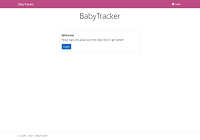
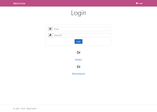
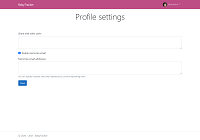
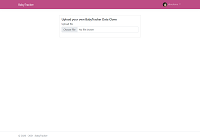
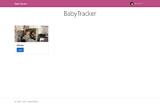
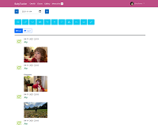
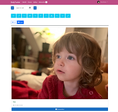
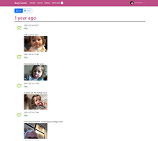
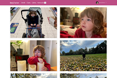
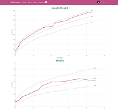

# BabyTracker
Website to view a Data Clone from the [BabyTracker](https://nighp.com/babytracker/) mobile app.

[](https://github.com/sboulema/BabyTracker/actions/workflows/workflow.yml)
[](https://github.com/sponsors/sboulema)

## Screenshots

### Account
[](https://raw.githubusercontent.com/sboulema/BabyTracker/main/art/Login.png)
[](https://raw.githubusercontent.com/sboulema/BabyTracker/main/art/LoginRegisterReset.png)
[](https://raw.githubusercontent.com/sboulema/BabyTracker/main/art/Profile.png)

Creating an account is really easy and protects all the data about your baby.<br>
In your profile you can enable the memories email and share a baby with another user.

### Import / Select baby
[](https://raw.githubusercontent.com/sboulema/BabyTracker/main/art/Import.png)
[](https://raw.githubusercontent.com/sboulema/BabyTracker/main/art/LoadBaby.png)

Import a Data clone from the BabyTracker mobile app and select which baby you want to view.<br>
Importing a Data clone is handled by [Tus](https://tus.io/) so even if your clone has a large size due to photo's, importing will still succeed.

### Diary
[](https://raw.githubusercontent.com/sboulema/BabyTracker/main/art/Diary.png)
[](https://raw.githubusercontent.com/sboulema/BabyTracker/main/art/DiaryCards.png)
[](https://raw.githubusercontent.com/sboulema/BabyTracker/main/art/Memories.png)
[](https://raw.githubusercontent.com/sboulema/BabyTracker/main/art/Gallery.png)

View all events logged with the BabyTracker app on the big screen!<br>
See your memories, what happened a year ago? what happened 2 years ago?<br>
See a gallery of all the baby photo's

### Charts

[](https://raw.githubusercontent.com/sboulema/BabyTracker/main/art/Charts.png)

BabyTracker shows you a number of different growth charts for your baby:
- Length/height
- Weight
- Head circumference
- BMI

Your babies data is plotted against the 3%, 50% and 97% percentile taken from the [WHO Child growth standards](https://www.who.int/tools/child-growth-standards/standards)


## Running
```
docker run -p 80:80 -e ... -e ... sboulema/babytracker
```

## Environment variables

| Variable					 | Description								|
|----------------------------|------------------------------------------|
| ASPNETCORE_ENVIRONMENT	 | .NET environment should be set to "Production" when using Docker, in order to used mapped volumes |
| AUTH0_CLIENTID			 | Auth0 client id used for authentication |
| AUTH0_CLIENTSECRET		 | Auth0 client secret used for authentication |
| AUTH0_DOMAIN				 | Auth0 domain to use for authentication |
| AUTH0_MACHINE_CLIENTID	 | Auth0 machine to machine client id used for user profile management |
| AUTH0_MACHINE_CLIENTSECRET | Auth0 machine to machine client secret used for user profile management |
| BASE_URL					 | Base url for links and images in the memories email |
| MEMORIES_CRON				 | Cron schedule on which to send the memories email |
| MEMORIES_FROM_EMAIL		 | Email address to use when sending memories email |
| MEMORIES_FROM_NAME		 | Email sender name to use when sending memories email |
| POSTMARK_API_TOKEN		 | Postmark API token used to send the memories email |
| BabyTrackerSync__Enabled	 | Set to `true` to show the experimental [Baby Tracker app sync](docs/baby-tracker-sync-api.md) settings on the profile page. Off by default |
| BabyTrackerSync__BaseUrl	 | Base url of the Baby Tracker sync server, defaults to `https://prodapp.babytrackers.com` |

## Volumes / Bind mounts

| Path on container | Description                         |
|-------------------|-------------------------------------|
| /data             | Data clones are stored at `/data/Data`, the encrypted Baby Tracker sync accounts at `/data/Sync` |

## Adding entries and syncing them to the app

The diary page has an **Add entry** button. Entries are written into your (encrypted) data clone on the server.
An entry added here only exists on the website until you import a new clone, which replaces it.

With `BabyTrackerSync__Enabled=true` the profile page gets an experimental **Baby Tracker app sync** card. When it is switched on,
the website logs in to the sync service of the app with your Baby Tracker account and sends every new entry as a transaction of
its own device, so the phones pick it up. This uses an unofficial, undocumented service: see
[docs/baby-tracker-sync-api.md](docs/baby-tracker-sync-api.md) for what is known, and try it with a spare account first.

## Requirements
- Auth0 account
- Postmark account

## Building Dependencies
- .NET 10.0
- NPM

### Debugging
Cron to easily test the `MemoriesJob` by running it every minute:
`0 0/1 * 1/1 * ? *`

## Links
https://www.who.int/tools/child-growth-standards/standards/length-height-for-age

## Disclaimer
This website is not produced, endorsed, supported, or affiliated with nighp software.